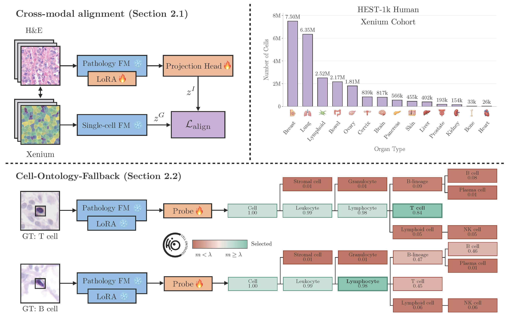

# CellBridge

This repository contains the full preprocessing, training, and evaluation pipeline for CellBridge from the preprint <a href="TODO">Fine-Grained and Reliable Cell Classification from Pathology Images</a>.

**CellBridge** is a multi-modal contrastive learning framework for fine-grained, reliable cell classification from H&E images, **pretrained on 16 million** paired H&E and Xenium spatial transcriptomic profiles.

**Cross-modal alignment** adapts a pathology encoder to learn from frozen spatial transcriptomic embeddings.
**Cell-Ontology-Fallback (COF)** uses branch-calibrated conformal prediction to select the supported cell-type granularity.

CellBridge requires **only H&E images at inference**, returning fine-grained labels when supported and broader ancestor categories when finer distinctions require molecular measurements.

<p align="center">

</p>

Start with the [tutorial notebook](notebooks/TUTORIAL.ipynb) for a end-to-end NuCLS example!

## 🚀 Installation

Use **Python 3.11** for the image encoder workflow.
From the repository root:

```bash
python3.11 -m venv .venv
source .venv/bin/activate
python -m pip install --upgrade pip
python -m pip install '.[models,data]'
python -m pip install -r requirements/encoders.txt
```

This installs CellBridge and the image encoder dependencies.
Inference downloads [adapter weights](https://huggingface.co/ogutsevda/cellbridge) automatically.

However, you also need access to the **UNI2-h backbone**, please see [model access](REPRODUCIBILITY.md#model-access).

For GPU setup, optional dependencies, or installation for CPU evaluation only, see [installation options](REPRODUCIBILITY.md#installation-options).

## 📊 Datasets

CellBridge uses HEST for training and held-out evaluation, and four external benchmarks: NuCLS, PanNuke, Lizard, and PhenoCell.
Organize the prepared data as:

```text
data/
├── train/hest/     # HEST metadata, labels, and teacher embeddings
└── eval/           # External benchmarks
    ├── nucls/
    ├── pannuke/
    ├── lizard/
    └── phenocell/
```

From the repository root, set these paths before running commands.
Replace `/path/to/...` with your own absolute paths:

```bash
export CELLBRIDGE_ROOT="$PWD"
export CELLBRIDGE_DATA_ROOT="/path/to/data"
export CELLBRIDGE_OUTPUTS_ROOT="/path/to/outputs"
export CELLBRIDGE_CHECKPOINTS_ROOT="/path/to/checkpoints"
export CELLBRIDGE_REPOS_ROOT="/path/to/external/model/repos"
```

See [data preparation](REPRODUCIBILITY.md#data-preparation) for required files, preprocessing commands, and setup.

## Training

Prepare the HEST artifacts and obtain UNI2-h access, then run:

```bash
cellbridge-train --config "$CELLBRIDGE_ROOT/configs/train/lora/cellbridge.yaml"
```

The paper config uses rank 8, alpha 16, batch size 16, and symmetric InfoNCE with temperature 0.07.

## Evaluation

Start with one dataset, for instance, NuCLS:

```bash
CONFIG="$CELLBRIDGE_ROOT/configs/inference/nucls.yaml"
RUN="$CELLBRIDGE_OUTPUTS_ROOT/reproducibility/inference/cellbridge/uni_terra_four_layers_adapted_all_cells/nucls"

cellbridge-infer check --config "$CONFIG" --method cellbridge --arm lora_adapted --output-dir "$RUN"
cellbridge-infer run --config "$CONFIG" --method cellbridge --arm lora_adapted --output-dir "$RUN" --device cuda
```

`check` validates data/configuration and resolves the adapter and downloads it on first use.

`run` extracts embeddings, evaluates linear and kNN probes, and runs conformal evaluation.

Use `extract` to compute and save embeddings from images.
Once saved, run `evaluate` or `conformal` for downstream analysis and conformal prediction, respectively.

## 🎯 Reproducibility!

Follow the [reproducibility guide](REPRODUCIBILITY.md) for installation options, model access, data preparation, experimental results, ablation studies, and notebooks for manuscript tables and figures.

```bash
bash scripts/reproduce.sh cellbridge check
bash scripts/reproduce.sh cellbridge run
# Repeat for uni, virchow2, volta, lemon, past, spatialwhisperer.
```

This runs evaluation for four OOD datasets (both PhenoCell tasks) and 14 HEST sections.

Notebooks 05, 06, 07, and 08 reproduce classification, conformal, qualitative, and ablation analyses.

Before opening the notebooks, install their dependencies with `python -m pip install '.[analysis]'` from the repository root.

## 📚 Citation

If this repository is helpful to you, please consider citing the associated paper:

```bibtex
TODO: Update after the arXiv submission.
```
